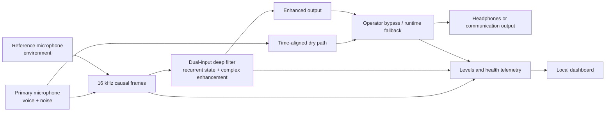

<div align="center">

# VoxShield

### Local speech enhancement for noisy defence communications

**Team@ · Smart India Hackathon 2026 · Problem Statement 26052**


**Capture → enhance → listen → measure.** A causal, dual-input model and an operator dashboard, with a reproducible training and evaluation pipeline.

[Get started](#quick-start) · [Architecture](#architecture) · [Evidence](#measured-evidence) · [Live demo](#live-demo) · [Limitations](#limitations-and-next-steps)

**Judges' evidence files:** [02 · Listen & record](docs/qr/02-listen-and-record.md) · [03 · Results](docs/qr/03-results-card.md) · [04 · Architecture](docs/qr/04-architecture-sheet.md) · [05 · Proof pack](docs/qr/05-proof-pack.md)

</div>

> [!IMPORTANT]
> VoxShield is a research prototype. The current Windows demo uses a JBL microphone and laptop microphone array as **separate audio devices**. They do not share a sampling clock. The model and software run, but this setup does not establish field performance, synchronized headset operation, or physical end-to-end latency. The broad v15 audit passes its strict gate; the harder military audit does not.

## Contents

- [Why this project exists](#why-this-project-exists)
- [What is in this repository](#what-is-in-this-repository)
- [Current status](#current-status)
- [Architecture](#architecture)
- [Quick start](#quick-start)
- [Data and training](#data-and-training)
- [Model export and evaluation](#model-export-and-evaluation)
- [Live demo](#live-demo)
- [Raspberry Pi 5](#raspberry-pi-5)
- [Measured evidence](#measured-evidence)
- [Reproducibility](#reproducibility)
- [Limitations and next steps](#limitations-and-next-steps)
- [Repository layout](#repository-layout)
- [Credits and licensing](#credits-and-licensing)

## Why this project exists

A short command can be lost beneath vehicle engines, rotor noise, wind, crowd sound or an impulse. For communication equipment, the goal is to make speech easier to understand while preserving the speaker's words, operating locally, and staying within a real-time audio deadline.

VoxShield grew from an inline audio-optimizer idea into a complete experiment platform. Its selected v15 path combines a **primary microphone** carrying voice and noise with an **environmental reference microphone**. It models both streams causally and produces enhanced speech. The project also includes data indexing, simulation, staged training, offline evaluation, stateful ONNX export, live inference, a dashboard and edge benchmarks. Earlier GTCRN, UL-UNAS fusion and v10 deep-filter experiments remain in the repository as development history; they are not all the current model.

## What is in this repository

| Area | Implementation |
| --- | --- |
| Data | Corpus adapters, deterministic splits, category tagging, leakage audit, fixed test mixtures |
| Models | Historical mono and fusion experiments; selected v15 causal dual-input deep filter |
| Training | Config inheritance, staged initialization, resume, TensorBoard logs and checkpoint selection |
| Validation | SNR, SI-SNR, STOI, optional PESQ, speech preservation and per-clip gates |
| Deployment | Stateful ONNX export and parity check, offline inference, live PortAudio runtime, Pi helpers |
| Operator view | Local dashboard with real input/output traces, controls, model identity and runtime counters |
| Evidence | Included v15 audit JSON, selected model files and historical project documentation |

The selected checkpoint, its ONNX export and [validation report](release/v15/voxshield-v15.validation.json), and the two 50-clip audit reports are versioned here. Original speech/noise datasets, personal recordings, generated mixtures, old training runs and full third-party checkouts are deliberately excluded. See [Data and training](#data-and-training) and [Reproducibility](#reproducibility).

## Current status

**Selected model:** `deep_filter_dual`, v15 hard-failure repair, initialized from the v14 weights. The current configuration is [`configs/deep_filter_v15_hard_failure_repair.yaml`](configs/deep_filter_v15_hard_failure_repair.yaml). The model consumes synchronized primary and reference features, predicts a bounded complex-domain enhancement, and carries explicit recurrent state between frames. Training and inference use 16 kHz audio.

| Milestone | Status | Evidence and meaning |
| --- | --- | --- |
| v15 ONNX export parity | Passed | Export compared with PyTorch within the recorded tolerance; see the [validation report](release/v15/voxshield-v15.validation.json). |
| v15 broad 50-clip audit | **Passed** | Strict gate passes; [report](release/v15/broad-50.json). |
| v15 harder military 50-clip audit | **Did not pass** | Mean scores improved, but per-clip STOI and joint target reliability missed the gate; [report](release/v15/military-50.json). |
| Earlier Pi 5 benchmark | Passed the measured model deadline | v10 ONNX, 10,000 frames: 5.33 ms mean, 6.05 ms p99 per 16 ms frame, zero deadline overruns. **This is not a v15 Pi benchmark or physical audio I/O latency.** |
| JBL + laptop dual-device demo | Experimental | Demonstrates the current UI and signal path. Separate Windows endpoints are not sample synchronized. |
| Shared-clock headset, physical loopback and field acceptance | Pending | Required before operational claims. |

## Architecture



The neural model is implemented in [`src/voxshield/df_model.py`](src/voxshield/df_model.py). [`runtime.py`](src/voxshield/runtime.py), [`live_engine.py`](src/voxshield/live_engine.py), [`live.py`](src/voxshield/live.py) and [`live_dual_device.py`](src/voxshield/live_dual_device.py) handle streaming, timing, buffering and audio endpoints. [`telemetry.py`](src/voxshield/telemetry.py) supplies state to the [local dashboard](src/voxshield/dashboard_ui.py).

The model path is causal and ONNX stateful. The live worker runs inference outside the audio callback. Bypass sends the aligned dry input when selected by the operator or required by the runtime. The dashboard shows captured signals and measured runtime counters; it does **not** claim live SNR, STOI or PESQ without a clean, time-aligned target. Software bypass is not a safety-rated hardware bypass.

## Quick start

The examples below use **PowerShell on Windows** from the repository root. The commands assume Python 3.10–3.13 and a working PortAudio device for live use. CUDA is optional for inference; training a large recipe is substantially faster with a GPU.

```powershell
git clone --recurse-submodules https://github.com/Jeswanth-009/VoxShield.git
cd VoxShield
py -3.12 -m venv .venv
& .\.venv\Scripts\python.exe -m pip install --upgrade pip
& .\.venv\Scripts\python.exe -m pip install -e ".[train,eval,pesq,onnx,live,dev]"
& .\.venv\Scripts\voxshield-smoke.exe
```

If your installed Python has a different supported version, create the environment with that interpreter. For the historical fusion/UL-UNAS experiments, restore the pinned upstream repositories as described in [Reproducibility](#reproducibility). The selected v15 deep-filter path uses the included release files.

### Verify the included model files

```powershell
Get-FileHash .\release\v15\best.pt -Algorithm SHA256
Get-FileHash .\release\v15\voxshield-v15.onnx -Algorithm SHA256
& .\.venv\Scripts\voxshield-benchmark.exe `
  --checkpoint .\release\v15\best.pt `
  --onnx .\release\v15\voxshield-v15.onnx `
  --device cpu --threads 1 --frames 2000 `
  --output .\local-benchmark.json
```

PowerShell uses backticks for line continuation. The expected SHA-256 values from the v15 export are listed in [Reproducibility](#reproducibility).

## Data and training

The repository does **not** redistribute VCTK, DNS Challenge, MUSAN, ESC-50, MAD, RIR collections, AudioSet material, or personal recordings. Obtain each dataset from its publisher under its own license. [`data/README.md`](data/README.md) explains adapters, directory layouts and categories; [`docs/datasets.md`](docs/datasets.md) gives the original acquisition context.

The ingestion command indexes audio in place and writes manifests; it does not copy the source audio. Paths in manifests are absolute, so re-ingest after moving a dataset. For a small local experiment:

```powershell
& .\.venv\Scripts\voxshield-data.exe ingest --manifest-dir manifests_demo --dry-run `
  --source "clean=D:\datasets\speech" `
  --source "noise:nonstationary=D:\datasets\engine"
# Remove --dry-run after checking the preview.
& .\.venv\Scripts\voxshield-data.exe audit --manifest-dir manifests_demo `
  --output .\local-data-audit.json --fail-on-leakage
```

The v15 recipe is a narrow repair of the v14 candidate. It loads v14 model weights, starts a new optimizer, oversamples hard examples and targets speech retention and intelligibility. Its paths point to **local** v14 manifests and fixed hard mixtures that are not published because they reference licensed external audio. To reproduce the original training run, reconstruct those inputs and the v14 checkpoint, then run:

```powershell
& .\.venv\Scripts\voxshield-train.exe --config .\configs\deep_filter_v15_hard_failure_repair.yaml --device cuda
```

The configuration's `model.initialize_from` and CLI `--resume` are mutually exclusive. For an interrupted run, use a copy of the config with `initialize_from: null`, then pass the matching `last.pt` to `--resume`. For a new dataset, create a new configuration and frozen validation mixtures rather than interpreting the published v15 numbers as results on your own data.

## Model export and evaluation

Export the provided checkpoint again and compare the generated ONNX graph with PyTorch:

```powershell
& .\.venv\Scripts\voxshield-export.exe `
  --checkpoint .\release\v15\best.pt `
  --output .\local-v15.onnx
```

The published ONNX graph uses opset 17. The original export reported a maximum enhanced-output absolute error of `1.82e-8` and state absolute error of `4.07e-6`, both below its `2e-4` tolerance. Those are **numerical parity** results, not audio-quality scores.

To evaluate on your own fixed dual-input mixture manifest:

```powershell
& .\.venv\Scripts\voxshield-evaluate.exe `
  --checkpoint .\release\v15\best.pt `
  --onnx .\release\v15\voxshield-v15.onnx `
  --manifest .\data\mixtures\your_fixed_set\manifest.jsonl `
  --device cpu --strict-sih-gate `
  --output .\local-evaluation.json
```

The included JSON reports contain the clip records, source labels, summary metrics, thresholds and pass/fail checks. The original test audio is not included, so the exact published audits cannot be rerun from this Git repository alone.

For offline enhancement, provide synchronized primary and reference audio. The v15 checkpoint will reject a missing reference:

```powershell
& .\.venv\Scripts\voxshield-infer.exe .\primary.wav .\enhanced.wav `
  --reference .\reference.wav `
  --checkpoint .\release\v15\best.pt `
  --onnx .\release\v15\voxshield-v15.onnx
```

## Live demo

### Recommended input geometry

For the intended dual-input use, capture both microphones through one shared-clock audio interface. Use a close-talk primary capsule and an outward-facing reference capsule. A Bluetooth headset plus a laptop array can illustrate the UI but introduces different device clocks, capture processing and uncertain acoustic alignment.

List the device IDs available **on your machine**:

```powershell
& .\.venv\Scripts\voxshield-live-dual-device.exe `
  --checkpoint .\release\v15\best.pt `
  --onnx .\release\v15\voxshield-v15.onnx `
  --list-devices
```

The helper [`scripts/run_v15_jbl_dashboard_demo.ps1`](scripts/run_v15_jbl_dashboard_demo.ps1) uses the included release pair by default and writes local telemetry under `artifacts/`. Device numbers change whenever hardware changes. Test both inputs with [`scripts/test_dual_mics.py`](scripts/test_dual_mics.py), then start the helper with your current IDs:

```powershell
& .\.venv\Scripts\python.exe .\scripts\test_dual_mics.py `
  --primary-device 1 --reference-device 2 --duration 15
powershell -ExecutionPolicy Bypass -File .\scripts\run_v15_jbl_dashboard_demo.ps1 `
  -PrimaryDevice 1 -ReferenceDevice 2 -OutputDevice 5 `
  -WetMix 1.0 -ControlledReferenceMix 0.30
```

The dashboard opens on loopback port 8765 or the next free port. The helper's default `ControlledReferenceMix = 0.30` adds a known amount of the laptop reference signal to the monitored noisy input so bypass makes the test noise audible. **Label this as a controlled demonstration.** Set `-ControlledReferenceMix 0` to remove that injection. Do not interpret either mode as a synchronized headset test. Use headphones to avoid feedback.

The dashboard includes input, reference and output motion; spectrum and band views; wet/dry controls; bypass and mute; level and correlation diagnostics; inference time, underflows, overruns, resets and model identity. Capture a continuous, direct-output A/B recording with unchanged phone-noise level, input gains and microphone geometry. The visual signals should come from the actual live session.

## Raspberry Pi 5

The included Pi scripts under [`scripts/pi/`](scripts/pi/) install and verify the **v10** path. The original Pi 5 (8 GB) verification used 10,000 16 ms frames: 5.33 ms mean inference, 6.05 ms p99, zero model deadline overruns and zero simulated callback drops. The reported full-pipeline p99 callback time was 6.50 ms. The command was `bash scripts/pi/verify-v10.sh` with the v10 checkpoint and ONNX artifact present on the Pi.

These numbers are from v10; the current v15 checkpoint has not been shown here with an equivalent Pi 5 report. A new v15 Pi verification must check matching hashes, mean and p99 timing, overruns, CPU and temperature under a sustained run. A physical loopback measurement is then needed for end-to-end microphone-to-headphone latency. [`docs/deployment-pi5.md`](docs/deployment-pi5.md) contains historical deployment procedures; check the model version in every command before using it.

## Measured evidence

The following values come from the two included v15 ONNX audit reports. Both used **50 curated/synthetic fixed clips**. Metrics are means across the reported set; the strict gate also checks per-clip target attainment. They are not field test results.

| Audit | Enhanced SNR | Enhanced STOI | Enhanced PESQ | Speech deletion | Strict gate |
| --- | ---: | ---: | ---: | ---: | --- |
| [Broad validation](release/v15/broad-50.json) | 30.48 dB | 0.938 | 3.94 | 0.0 | **Pass** |
| [Military-focused validation](release/v15/military-50.json) | 25.15 dB | 0.915 | 3.63 | 0.0 | **Fail:** STOI and joint target reliability |

The broad result is encouraging, and the military set shows the unresolved reliability problem. The military audit's average values do not erase its difficult individual clips. The quality gate complements listening tests and cannot prove performance on a different headset, acoustic layout or battlefield recording. The earlier v14 broad audit failed its strict reliability gate; v15 repaired the broad set but did not close the military set.

## Reproducibility

| File | SHA-256 from recorded v15 export |
| --- | --- |
| [v15 checkpoint](release/v15/best.pt) | `9af778772b9a4c531106cd244f56bcb326f1b00056a67762b1dca790d5799629` |
| [v15 ONNX](release/v15/voxshield-v15.onnx) | `33e352558a33670dfd65e6412c89c13f50b94140721672c09c9ae43701bc4307` |

Recompute the hashes after downloading. The checkpoint and graph form a pair. Do not mix model versions during export, evaluation or a live demo.

Earlier research architectures load pinned upstream Python sources from `external/`. They are linked as Git submodules at the tested commits. If an existing clone lacks them, run:

```powershell
git submodule update --init --recursive
```

Pinned commits: GTCRN `502ebfab64da7c4a9af78dcb9c6ceef1ebb01c73`; UL-UNAS `00f7c700da43d38347f30a6ccebd86fcbc798e07`; H-GTCRN `36dde1b90a0acf97d17826454363d841ed7ad046`. Submodules are separate upstream projects; their weights and sample audio are not part of the VoxShield release. Follow their licenses and download instructions if an older experiment needs them. See [`THIRD_PARTY_NOTICES.md`](THIRD_PARTY_NOTICES.md).

## Limitations and next steps

1. **Shared-clock capture:** integrate two capsules with one audio interface, then measure reference leakage, alignment and drift.
2. **Real target recordings:** record clean speech, representative noise and paired microphone signals with the intended headset geometry. Recheck any device DSP or automatic gain control.
3. **Hard-case reliability:** inspect the military audit's failed clips and retrain only against a held-out, non-leaking evaluation set.
4. **Physical latency and endurance:** measure the full microphone-to-output loop with hardware, then run long-duration tests under thermal load with no dropped or underflowed audio.
5. **Human evaluation:** run blinded listening and command-intelligibility checks. Report both average and worst-case outcomes.
6. **Deployment safety:** design an independent hardware bypass and power-failure path before considering operational use.

No claim in this repository implies approval for a defence deployment. The software is a platform for the remaining measurements.

## Repository layout

```text
VoxShield/
├── src/voxshield/       Python models, data pipeline, runtime and dashboard
├── configs/             Historical and current training recipes
├── scripts/             Dataset, demo, packaging and Pi helpers
├── tests/               Automated correctness and regression tests
├── docs/                Architecture, datasets, deployment and project history
├── release/v15/         Selected checkpoint, ONNX, validation and audit JSON
├── data/README.md       Data acquisition, indexing and split guidance
├── pyproject.toml       Package metadata and command-line entry points
└── THIRD_PARTY_NOTICES.md
```

Documentation under `docs/` records the project's evolution and may discuss older selected candidates. Use this README, the v15 config and versioned evidence files for the current status. Read the version and date printed inside each historical note before reusing commands or claims.

## Credits and licensing

Team@ developed VoxShield for SIH 2026 Problem Statement 26052. The repository includes original project code and acknowledges external GTCRN, UL-UNAS, H-GTCRN and dataset projects. Their work and model results remain attributed to their authors. See [third-party notices](THIRD_PARTY_NOTICES.md).

There is currently **no root-level open-source license** for the original VoxShield code. Public availability on GitHub does not itself grant permission to reuse or redistribute it. Upstream projects retain their own licenses, and datasets retain the terms set by their publishers. The selected model files are published for project review; contact the repository owner before repackaging them.
