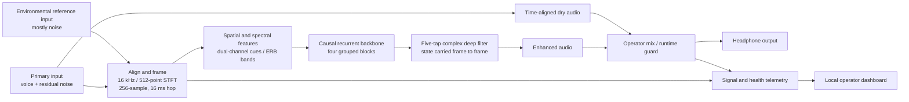

# 04 — How VoxShield v15 works

**Current deployed experiment:** a local, causal, dual-input speech-enhancement engine with a monitored dry path. The JBL microphone and laptop array are the present **Windows demonstration inputs**. A shared-clock dual-capsule headset/audio interface is the **target design**, not completed hardware.

| Verified implementation fact | Source |
| --- | --- |
| 16 kHz audio, 512-point STFT, 256-sample (16 ms) hop | Configuration embedded in [v15 checkpoint](../../release/v15/best.pt) |
| `deep_filter_dual`, 160 channels, four recurrent blocks, five history taps | [v15 configuration](../../configs/deep_filter_v15_hard_failure_repair.yaml) and [model code](../../src/voxshield/df_model.py) |
| 1,141,389 trainable parameters; recurrent state is carried across frames | Loaded v15 checkpoint and [model code](../../src/voxshield/df_model.py) |
| Stateful ONNX export and hash-verified checkpoint/graph pair | [validation report](../../release/v15/voxshield-v15.validation.json) and [verification code](../../src/voxshield/checkpoint.py) |
| Dry, enhanced and automatic operating modes, with measured runtime counters | [dual-device runtime](../../src/voxshield/live_dual_device.py), [engine](../../src/voxshield/live_engine.py), [dashboard](../../src/voxshield/dashboard_ui.py) |

The model receives **both** primary and reference signals. The reference is not an extra speaker channel and cannot simply be replaced by a Windows stereo-mix device. It should carry environmental noise with less speech than the primary. The present JBL/laptop pair has separate clocks, may contain microphone DSP, and uses software alignment; it demonstrates the workflow but does not prove a synchronized hardware product.

### What the safety path means—and does not mean

The software can route time-aligned dry input when the operator selects bypass or the runtime degrades. This is **software continuity**, not an independent, safety-rated electrical bypass. A production communication device would need a separate power-failure/hardware path and measured failure behaviour.

### Versions in one line

Earlier GTCRN/UL-UNAS fusion experiments remain in the repository. The selected **v15** uses the dual-input deep-filter architecture developed in v10 and fine-tuned through v14/v15. Do not label the current v15 model “GTCRN” or “UL-UNAS.”
